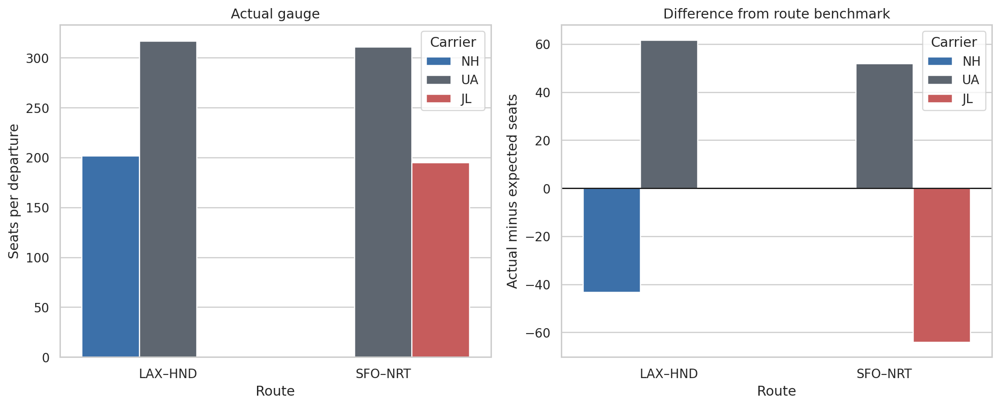

# Airline fleet allocation in East Asia

How do airlines combine aircraft size and flight frequency, and which carrier–route combinations differ from a descriptive market benchmark?

This project combines U.S. DOT traffic records with a Taipei–Hong Kong case study to examine fleet renewal, reporting quality, and persistent carrier differences in **2019 and 2023–2025**. It turns aircraft-code and freight anomalies into explicit audit rules before fitting departure-weighted models.

**Start with the [executed analysis notebook](notebooks/fleet_allocation.ipynb).** It includes the figures and tables, so no local setup is needed to read the findings.



## Main findings

| Finding | Evidence |
| --- | --- |
| Market recovery mainly reflects flight frequency | Continental U.S.–Asia widebody departures fell from 113,532 in 2019 to 102,388 in 2025; average gauge stayed near 290 seats |
| Carrier-wide patterns matter | Adding carrier indicators increases departure-weighted, in-sample R² from 0.658 to 0.789 |
| Smaller aircraft can accompany higher frequency | ANA's LAX–HND operation averages about 202 seats and two daily round trips in 2025; United averages about 317 seats and one |
| Cabin density is a plausible explanation for some differences | JAL's SFO–NRT operation averages about 195 seats, versus United's 311; traffic data alone cannot establish fare or profit differences |
| Measured freight adds little to this benchmark | On the identical reliable-freight sample, adding freight increases in-sample R² by 0.0037 |

The two U.S.–Japan routes are illustrative cases. They are not presented as the two largest contrasts in the sample.

## Data and method

The main source is [BTS T-100 International Segment (All Carriers)](https://www.transtats.bts.gov/DL_SelectFields.aspx?QO_fu146_anzr=Nv4Pn44vr45&gnoyr_VQ=FJE). The regional case uses [Taiwan CAA annual route/airline traffic tables](https://www.caa.gov.tw/article.aspx?a=1746). See [data setup and definitions](data/README.md) for source years, filenames, and the exact market scope.

The benchmark has **7,599 carrier–route–direction–month observations, 45 routes, and 20 carriers**. Weighted OLS relates seats per departure to log monthly departures and route, direction, year, and month indicators. Carrier indicators and reliable freight provide two separate sensitivity checks. Annual comparisons weight observations by performed departures.

The preparation pipeline preserves reported aircraft labels, records 120 reviewed SQ-to-777 corrections and 88 reviewed SQ/OZ-to-A380 corrections, removes 14 explicitly freighter-coded rows, and excludes 394 unresolved aircraft–seat rows from the model. Aircraft corrections reflect carrier-specific manual review, not a universal rule that a given seat count identifies an aircraft.

## Interpretation

These are descriptive, in-sample comparisons. A positive residual means larger gauge than the fitted benchmark; it does not establish overcapacity or inefficiency. Fares, cabin mix, connecting demand, slots, costs, and aircraft availability are unobserved. Current published seat maps offer context rather than proof of historical route-specific layouts. The model does not estimate optimal fleet allocation or profitability.

## Reproduce

Tested with Python 3.12. From this project folder, create an environment and install dependencies:

```bash
python3 -m venv .venv
source .venv/bin/activate
python -m pip install -r requirements.txt
```

On Windows, create the environment with `py -3.12 -m venv .venv` and activate it using `.venv\Scripts\activate` in Command Prompt.

Place the five traffic ZIPs in `data/raw/`, as described in [data/README.md](data/README.md). The public aircraft lookup is already included. Then run:

```bash
python run_analysis.py
python -m unittest discover -s tests -v
```

The runner executes every notebook cell in a fresh Python process and saves the resulting notebook, figures, tables, input fingerprints, and environment record. It does not need a Jupyter server. To work interactively, open the notebook in your usual Jupyter environment and select this Python environment; the same cells support Run All.

## Repository map

| Location | Contents |
| --- | --- |
| `notebooks/` | One executed narrative analysis |
| `src/data.py` | Source readers, aircraft corrections, freight screening, audit tables |
| `src/models.py` | Weighted models and annual aggregation |
| `data/` | Acquisition instructions and public aircraft reference |
| `figures/` | Three selected figures |
| `results/` | Aggregate CSV outputs, run summary, input fingerprints, environment |
| `tests/` | Correction-scope and weighting checks |

Raw traffic archives are ignored by Git. [Validation notes](VALIDATION.md) describe the rerun and comparison with the original analysis.
